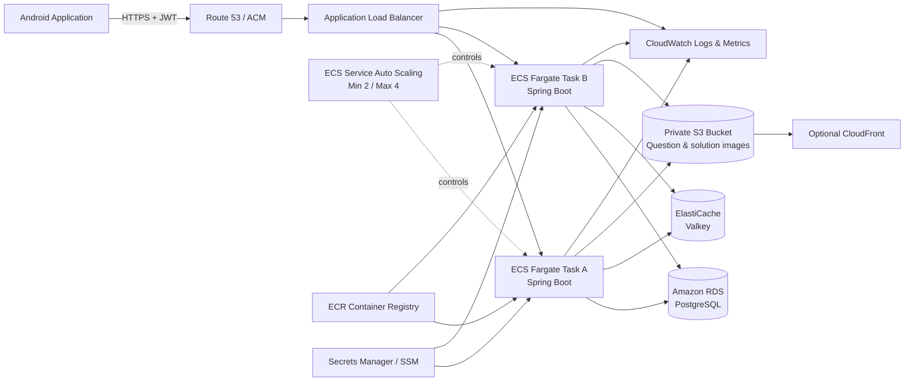

# GATE CS Practice Platform

## Interview, Resume, Architecture, and Future Integration Guide

> **Document purpose:** This is the source of truth for explaining the project in interviews and writing it on a resume. It separates completed work from work in progress and future AWS work so that no claim is exaggerated.
>
> **Current project status:** Local Android application and local Spring Boot backend under active development. AWS production deployment has not yet been completed.

---

## 1. Executive Summary

GATE CS Practice is a full-stack learning platform for GATE Computer Science aspirants. It organizes previous-year questions by subject and module, provides full-length timed mock tests, and is being integrated with authenticated cross-device progress and protected server-delivered content.

The project has three major parts:

1. **Offline content engineering pipeline** written in Python:
   - Processes official GATE papers and a GATE preparation book.
   - Uses PDF text extraction where possible and OCR where necessary.
   - Segments papers into individual questions.
   - Classifies questions into subjects and modules.
   - Extracts answers and worked solutions.
   - Produces normalized JSON and WebP assets.

2. **Android application** written in Kotlin and Jetpack Compose:
   - Public Home screen with coverage statistics and 12 subject cards.
   - Subject and module navigation.
   - MCQ, MSQ, and NAT practice flows.
   - Five full-length mock tests with timer, palette, review state, scoring, results, and solution review.
   - Local caching and progress state.
   - Authentication and backend networking are being integrated.

3. **Spring Boot backend** written in Java 17:
   - Registration and login with custom JWT authentication.
   - Rotating refresh tokens stored as hashes.
   - PostgreSQL schema managed by Flyway.
   - Monthly partitioning of the growing attempts table.
   - Protected question, image, progress, and mock-test APIs.
   - Server-controlled mock timer and server-side scoring.
   - Local image storage with an implemented S3 adapter.

The planned AWS production architecture uses an Application Load Balancer, ECS Fargate autoscaling, Amazon RDS for PostgreSQL, ElastiCache for Valkey/Redis-compatible caching, S3 for image storage, and CloudWatch for observability.

---

## 2. Project Status: What Is Done, In Progress, and Planned

### 2.1 Implemented and verified locally

- Parsed **18 official GATE CS papers from 2015–2025**, containing 1,170 questions.
- Added **938 additional questions** from a GATE CS previous-year-question book covering older years and extra sets.
- Produced **2,108 practice questions** organized into 12 subject groups and their modules.
- Attached answers to 1,945 practice questions and worked-solution images to 1,951 questions.
- Created **five full-length mock tests**, each containing 65 questions and 100 marks.
- Built the Android Home, subject, module, practice, mock-test, results, and review interfaces.
- Added native-text rendering for 1,875 of the 2,108 practice questions, with image fallback for unsafe OCR/layout cases.
- Implemented a Spring Boot API with PostgreSQL, Flyway, JWT security, progress endpoints, mock sessions, image endpoints, and server-side grading.
- Ran the backend locally using embedded PostgreSQL.
- Verified that the backend imported **12 subjects, five mock tests, and 2,433 total questions**: 2,108 practice questions plus 325 mock questions.
- Verified that protected content endpoints return HTTP 401 without authentication.
- Built an integration-test workflow covering authentication, content access, progress, mock scoring, refresh-token rotation, and logout.

### 2.2 In progress

- Completing the Android login and signup screens.
- Showing the public Home and Mock Test catalog before login while protecting actual subject and mock content.
- Redirecting unauthenticated users to login when they tap a subject or mock test.
- Completing the Android API wiring after the data layer was changed from bundled JSON to network responses.
- Rebuilding and testing the Android app after the latest networking changes.
- Making offline progress synchronization durable. Currently, some writes are optimistic and fire-and-forget; a persistent retry queue is still required.
- Persisting unsent mock autosave changes immediately so a process kill cannot lose the last delayed update.

### 2.3 Planned, not yet deployed

- Amazon RDS for PostgreSQL.
- ECS Fargate deployment of the Spring Boot container.
- Application Load Balancer across two backend tasks.
- ECS Service Auto Scaling from two to four tasks.
- ElastiCache using the Valkey engine, accessed through Spring Data Redis.
- S3 storage for question, figure, and solution images.
- CloudFront in front of S3 if image traffic justifies it.
- Route 53 domain and ACM TLS certificate.
- CloudWatch dashboards, alarms, logs, and custom online-user metrics.
- Terraform infrastructure as code.
- Docker image publishing through Amazon ECR.
- CI/CD pipeline for tests, container build, and deployment.
- k6 load testing with measured latency and throughput.
- AI Doubt Solver implementation. The Android tab currently shows a “Coming soon” screen.

### 2.4 Claims that must not be made yet

Do not currently say:

- “The platform is deployed on AWS.”
- “It handles 300 concurrent users in production.”
- “Redis reduced latency by X%.”
- “Autoscaling reduced p95 latency to X ms.”
- “The system supports 1,000 active users.”
- “CloudFront reduced image latency by X%.”

Those statements are valid only after deployment and a documented load test. Until then, say that the architecture is implemented locally or planned, and that load tests are the next validation step.

---

## 3. Problem Statement

GATE aspirants often use disconnected PDFs, books, answer keys, screenshots, and websites. This creates several problems:

- Questions are not consistently grouped by syllabus topic.
- Learners cannot easily measure subject or module coverage.
- Formulas, diagrams, code blocks, and tables are difficult to extract reliably.
- Full-length test practice lacks a consistent timer, marking scheme, and review experience.
- Progress does not automatically follow a learner across devices.
- Large collections of question images make an Android package unnecessarily large.

The project solves these problems by converting raw examination documents into structured content, exposing that content through a secure API, and presenting it in a focused Android learning experience.

---

## 4. Target Users and Scope

### Target users

- GATE Computer Science and Information Technology aspirants.
- Initial planned scale: approximately **1,000 registered users**.
- Expected normal concurrency: approximately **5–10 active users**.
- Scaling demonstration target: a synthetic spike of **300 online users**.

### Product scope

- Previous-year-question practice.
- Subject and module coverage tracking.
- MCQ, MSQ, and numerical-answer questions.
- Full-length mock tests.
- Authentication and cross-device progress.
- Protected solution images.
- Future AI-assisted explanations.

### Explicit non-goals for the first production release

- Social networking.
- Live classes.
- Payments or subscriptions.
- Real-time multiplayer tests.
- A microservice for every feature.
- Kafka without a real multi-consumer event-stream requirement.

---

## 5. Data Engineering and OCR Pipeline

### 5.1 Source documents

The repository contains:

- 18 official GATE CS question papers from 2015 to 2025.
- A GATE CS previous-year-question book covering 2005–2026.
- Five full-length mock-test PDFs.

### 5.2 Pipeline stages

#### Stage 1: PDF text extraction and OCR

`_work/extract_lines.py` reads each PDF page at 2× scale.

- If a page has a useful text layer, `pdfplumber` extracts text and bounding boxes.
- If the body text contains fewer than a configured number of characters, RapidOCR is used.
- OCR is forced for the 2017 papers because their text layers contain headings but the question bodies are images.

This hybrid strategy avoids running OCR on every page and preserves higher-quality text where the PDF already contains it.

#### Stage 2: Question segmentation

`_work/segment.py`:

- Detects question-number markers.
- Handles separate General Aptitude and Computer Science numbering styles.
- Removes page headers and footers.
- Recovers missing boundaries using whitespace gaps.
- Joins questions that continue across pages.
- Produces individual question crops and per-paper metadata.

#### Stage 3: Subject and module classification

`_work/classify.py` assigns subjects and modules using weighted keyword and regular-expression rules. The generated results were reviewed and corrected manually, especially for General Aptitude and borderline questions.

#### Stage 4: Book parsing and matching

The scripts under `_work/book/`:

- Extract positioned words and graphics from book pages.
- Detect question and solution sections.
- Crop question and worked-solution images.
- Match book entries to official-paper questions.
- Add older or otherwise missing questions as new records.

#### Stage 5: Native text reconstruction

The application pipeline reconstructs stems and options from positioned PDF text:

- Paragraph blocks.
- Monospace code blocks.
- Superscript and subscript markup.
- Fractions and square-root notation.
- Small figure crops inserted in reading order.
- A–D option parsing.

Safety checks reject text when reconstruction is unreliable. Examples include malformed mathematics, missing options, orphaned superscripts, grids, or ambiguous figure placement. Rejected questions use the original image rather than presenting incorrect text.

### 5.3 Corpus results

| Content | Count |
|---|---:|
| Official-paper questions | 1,170 |
| Additional book questions | 938 |
| Practice questions | 2,108 |
| Practice questions with answer | 1,945 |
| Practice questions with worked solution | 1,951 |
| Native-text practice questions | 1,875 |
| Practice image fallbacks | 233 |
| Full mock tests | 5 |
| Mock questions | 325 |
| Total backend questions | 2,433 |

### 5.4 Quality and content limitations

- OCR output is not treated as automatically correct.
- Risky reconstruction falls back to the source image.
- Some official-paper-only questions do not have answer keys or solutions in the book.
- Four mock explanations are absent from the source PDFs: Mock 1 Q32/Q33 and Mock 5 Q16/Q17.
- Answers sourced from the preparation book have not all been independently checked against official answer keys.
- Some duplicate questions remain because the same question can appear in multiple official sets.
- Publishing third-party book or mock-test content publicly may require permission. This should be resolved before releasing the application commercially or through an app store.

---

## 6. Android Application

### 6.1 Technology

- Kotlin.
- Jetpack Compose.
- Material 3.
- Navigation Compose.
- Kotlin serialization.
- OkHttp.
- Coil for image loading and caching.
- AndroidX Security Crypto for encrypted token storage.
- Minimum SDK 26; compile and target SDK 34.

### 6.2 Screens and behavior

#### Home

- Publicly visible before login.
- Shows overall coverage, correct answers, wrong answers, and accuracy.
- Shows the most recently opened topic.
- Displays 12 subjects with topic-specific vector icons.
- Subject names and module metadata can be loaded from the public catalog API.

#### Subject and module navigation

- Tapping a subject should require authentication.
- After login, the user sees the subject’s modules and progress.
- Tapping a module opens one question at a time.

#### Practice

- Supports MCQ, MSQ, and NAT.
- Shows native stem and option text where extraction is safe.
- Shows original question images as a fallback.
- Shows code in a horizontally scrollable monospace block.
- Shows figures separately and supports pinch-to-zoom.
- Gives immediate feedback on a practice answer.
- Opens the solution automatically after a wrong answer.
- Stores attempts, viewed questions, and the last position.

#### Mock Tests

There are five full-length mock-test cards. Each mock has:

- 65 questions.
- 100 marks.
- 180-minute duration.
- General Aptitude and Computer Science sections.
- MCQ negative marking.
- No negative marking for NAT questions.

During a mock test the user can:

- Select or clear an answer.
- Mark a question for review.
- Navigate with Previous/Next or the question palette.
- See answered, visited, marked, and unvisited states.
- Leave and resume the test.
- Submit manually or be submitted when the timer expires.

After submission the user sees:

- Total score.
- Correct, wrong, and skipped counts.
- Accuracy.
- Time taken.
- General Aptitude and Computer Science scores.
- Color-coded question outcomes.
- Correct answers and solution images.
- Retake option.

### 6.3 Authentication behavior being implemented

The desired user flow is:

1. App starts and shows the same Home interface without requiring login.
2. Public catalog metadata is visible.
3. User taps one of the 12 subjects or a mock-test card.
4. If the user is not authenticated, the app navigates to Login/Signup.
5. After successful authentication, the originally requested subject or mock resumes automatically.
6. Questions, images, progress, and mock sessions are loaded from the backend.
7. The user stays signed in using a refresh token.
8. Logout clears account-specific question caches, progress, mock state, and image caches.

### 6.4 Mobile security

- Access and refresh tokens are stored in encrypted preferences where the Android Keystore is available.
- The API client adds bearer tokens only to the configured backend host.
- A single failed request can trigger access-token refresh and retry.
- Refresh failure clears the local session.
- The release build is intended to use HTTPS only.
- Debug cleartext HTTP is restricted to the emulator host `10.0.2.2`.
- Account-specific files and image caches are deleted at logout.

### 6.5 Offline behavior

Implemented design:

- Public catalog uses network, then downloaded cache, then bundled fallback.
- Previously downloaded questions can be opened from per-user disk cache if the server is unreachable.
- Coil caches protected images on disk.
- Progress is shown optimistically in the UI and saved locally.

Required improvement:

- Add a durable sync queue, such as a Room table or append-only operation log.
- Retry failed writes with exponential backoff using WorkManager.
- Give each write an idempotency key.
- Resolve conflicts using server timestamps or operation ordering.

This is important because swallowing a failed network write can make local and server progress diverge.

---

## 7. Spring Boot Backend

### 7.1 Technology

- Java 17.
- Spring Boot 3.3.5.
- Spring Web.
- Spring Security.
- OAuth2 Resource Server support for JWT validation.
- Spring Data JPA and Hibernate.
- PostgreSQL JDBC driver.
- HikariCP.
- Flyway.
- Caffeine local cache during development.
- AWS SDK v2 for S3.
- Actuator.
- Embedded PostgreSQL for local development and integration tests.

### 7.2 API security model

Public endpoints:

- Authentication endpoints.
- Subject/module catalog metadata.
- Mock-test catalog metadata.
- Health endpoint.

Protected endpoints:

- Questions.
- Solution and question images.
- User progress.
- Mock sessions and submissions.
- Leaderboards.
- Account profile.

The protection is intentional: the Home interface remains visible, but the actual content requires an authenticated user.

### 7.3 JWT authentication

The custom authentication flow uses:

- BCrypt with work factor 11 for password hashes.
- Short-lived access JWTs, currently 15 minutes.
- Long-lived refresh tokens, currently 30 days.
- Random opaque refresh tokens.
- SHA-256 hashes of refresh tokens in PostgreSQL. Raw refresh tokens are never stored.
- Refresh-token rotation: each successful refresh invalidates the old token and issues a new one.
- Reuse detection: reusing an already-consumed refresh token is treated as possible theft and revokes the user’s refresh-token family.
- Logout revocation.
- Generic incorrect-login errors to avoid revealing which email addresses exist.
- Login throttling.

### 7.4 Important security clarification for AWS

For local development, AWS keys may be placed in a git-ignored `.env` file. For ECS production, long-lived AWS access keys should **not** be placed in the container environment if they can be avoided.

Preferred production approach:

- Assign an IAM task role to the ECS task.
- Grant only the required S3 actions and bucket prefix.
- Let the AWS SDK obtain temporary credentials from the task role.
- Store the JWT signing secret and database credentials in AWS Secrets Manager or SSM Parameter Store.
- Inject secrets into the task definition at deployment time.

This provides short-lived credentials and reduces the damage of a leaked `.env` file.

### 7.5 Main endpoints

#### Authentication

| Method | Route | Purpose |
|---|---|---|
| POST | `/api/auth/register` | Create account and issue tokens |
| POST | `/api/auth/login` | Authenticate and issue tokens |
| POST | `/api/auth/refresh` | Rotate refresh token and issue a new access token |
| POST | `/api/auth/logout` | Revoke refresh token |
| GET | `/api/me` | Return authenticated user profile |

#### Public catalog

| Method | Route | Purpose |
|---|---|---|
| GET | `/api/catalog` | Subject and module names/counts |
| GET | `/api/catalog/mocks` | Mock-test names, marks, duration, and sections |

#### Practice content and progress

| Method | Route | Purpose |
|---|---|---|
| GET | `/api/modules/{moduleId}/questions` | Return questions for one module |
| GET | `/api/progress` | Return the user’s practice progress |
| POST | `/api/progress/attempts` | Grade and store a practice answer |
| DELETE | `/api/progress/attempts/{questionId}` | Clear attempts for a question |
| PUT | `/api/progress/viewed/{questionId}` | Mark/unmark a no-key question as practised |
| PUT | `/api/progress/state` | Save last subject/module and positions |

#### Mock tests

| Method | Route | Purpose |
|---|---|---|
| GET | `/api/mock-summary` | Latest session, best score, and attempt count for each mock |
| GET | `/api/mocks/{mockId}/questions` | Return mock questions without answers |
| GET | `/api/mocks/{mockId}/session` | Return latest session |
| POST | `/api/mocks/{mockId}/start` | Start or resume a server-timed session |
| PUT | `/api/mocks/{mockId}/session` | Autosave answers, review state, and position |
| POST | `/api/mocks/{mockId}/submit` | Grade and finalize test |
| GET | `/api/mocks/{mockId}/leaderboard` | Return rank data |

#### Images and health

| Method | Route | Purpose |
|---|---|---|
| GET | `/api/images/{q\|s\|f}/{name}.webp` | Return protected question, solution, or figure image |
| GET | `/actuator/health` | Load-balancer health check |

### 7.6 Server-side grading

Practice and mock answers are graded by the server rather than trusting a client-supplied score.

- MCQ: selected option set must equal the answer set.
- MSQ: all correct options and no incorrect options are required.
- NAT: value must fall within the accepted range.
- Correct answer: +1 or +2 based on question marks.
- Wrong MCQ: minus one-third of the marks.
- Wrong NAT: zero negative marks.
- Unanswered: zero.

Mock answer keys are omitted before submission and returned only after finalization. This prevents simple inspection of the question API from revealing the answers during a test.

### 7.7 Mock timer integrity

The server stores:

- Start timestamp.
- Test duration.
- Answers.
- Visited questions.
- Marked-for-review questions.
- Current position.
- Finished timestamp and score.

The phone displays a countdown using server time adjusted for local clock skew. The backend decides whether a submission is inside the allowed time and allows a small network grace period. The client cannot create a valid longer test simply by changing the phone clock.

---

## 8. PostgreSQL Data Model and Partitioning

### 8.1 Main tables

| Table | Purpose |
|---|---|
| `users` | Account identity and BCrypt password hash |
| `refresh_tokens` | Hashed, expiring, revocable refresh tokens |
| `subjects` | Subject metadata |
| `modules` | Module metadata under subjects |
| `questions` | Practice and mock questions, answers, text blocks, options, metadata |
| `mock_tests` | Mock metadata, sections, duration, and marks |
| `attempts` | Historical practice attempts |
| `viewed` | No-answer-key questions marked as practised |
| `user_state` | Last topic and module positions |
| `mock_sessions` | Mock answers, timer, status, score, and section results |

### 8.2 Partition strategy

The `attempts` table is range partitioned by month using `created_at`.

Why this table:

- It grows with every practice submission.
- Users can retry questions, so retaining attempt history creates many rows.
- Date-based analytics and deletion can benefit from partition pruning.
- Old data can be archived or removed one partition at a time.
- Per-partition indexes remain smaller.

A scheduled job ensures current and future monthly partitions exist.

### 8.3 Honest partitioning explanation

At the initial scale of 1,000 registered users and 5–10 concurrent users, PostgreSQL partitioning is not required for performance. It is included to demonstrate and validate a growth strategy for a write-heavy historical table.

A good interview answer is:

> “The present data volume does not require partitioning. I partitioned the historical attempts table by month because it has clear time-based lifecycle and analytics queries. The main immediate benefit is easier retention and index management. I would confirm partition pruning with EXPLAIN ANALYZE and keep a non-partitioned design if measurements showed no operational benefit.”

Do not describe PostgreSQL partitioning as horizontal sharding. It remains inside the same database instance unless a separate sharding design is introduced.

### 8.4 RDS choice

The planned database is **Amazon RDS for PostgreSQL**, initially a Single-AZ micro instance for cost control.

Reasons:

- The data is relational.
- The project needs constraints and joins.
- Mock and progress updates benefit from transactions.
- PostgreSQL supports JSONB for flexible question blocks and mock state.
- PostgreSQL supports declarative partitioning.
- RDS provides backups, patching, monitoring, and managed storage.

Aurora is not selected for the first deployment because the workload does not justify its higher baseline cost.

---

## 9. Image Storage

### Current local mode

The backend reads WebP images from `gate-backend/content/images` and returns them only after authentication.

Security measures:

- Only `q`, `s`, and `f` folders are accepted.
- Filenames must match a restricted pattern.
- Paths are normalized.
- Resolved paths must remain inside the content root.

### Planned S3 mode

The S3 adapter is already implemented but has not been deployed or tested against a real bucket.

Production flow:

1. Android requests an image endpoint with an access token.
2. Spring Security validates the token.
3. The backend creates a short-lived S3 pre-signed URL.
4. The client follows the redirect and downloads directly from S3.
5. Coil caches the image on disk.

Benefits:

- The backend does not stream large image files.
- ECS tasks use less CPU and network bandwidth.
- S3 is durable and inexpensive.
- Images can later be served through CloudFront.

The S3 bucket must remain private. The IAM task role should only have access to the expected image prefix.

---

## 10. Redis / Valkey Design

### Current state

- Redis is not required for local development.
- The backend currently uses Caffeine local cache with a 30-minute expiry.
- Login throttling is currently in memory.
- Leaderboards currently query PostgreSQL.

### Planned ElastiCache uses

Use Amazon ElastiCache with the Valkey engine. Valkey is Redis protocol compatible and Spring Data Redis can use it.

Good use cases in this project:

1. **Catalog and question metadata cache**
   - Key: module or mock identifier.
   - Value: serialized question response.
   - TTL: 15–30 minutes.

2. **Login and AI-chat rate limits**
   - Counters with expiry.
   - Shared between all backend tasks.

3. **Online-user tracking**
   - Sorted set where score is last-seen timestamp.
   - Count users active in the last 60 seconds.

4. **Mock leaderboard**
   - Sorted set keyed by mock test.
   - PostgreSQL remains the source of truth.
   - Redis provides fast ranking and top-N reads.

5. **Idempotency keys**
   - Short-lived record of processed mock submissions or mutation requests.

### What Redis should not store as the only copy

- User accounts.
- Final mock scores.
- Practice history.
- Refresh tokens.
- Irreplaceable question data.

Redis/Valkey is treated as a cache and coordination layer. PostgreSQL remains authoritative.

---

## 11. Planned AWS Architecture



### 11.1 Request flow

1. The Android app sends HTTPS requests to one API hostname.
2. The ALB terminates TLS and selects a healthy backend target.
3. Spring Security validates the JWT.
4. The stateless backend task reads and writes shared state in PostgreSQL and Redis/Valkey.
5. Protected image requests receive short-lived S3 pre-signed URLs.
6. CloudWatch receives application logs, ALB metrics, and service metrics.

The Android app does **not** call two different backend URLs. It always calls one ALB URL. The ALB distributes requests among two or more task endpoints.

### 11.2 Availability zones

- Put the ALB in two public subnets across two Availability Zones.
- Run at least one Fargate task in each zone.
- For the cost-controlled first release, tasks may use public subnets with security groups that allow inbound traffic only from the ALB.
- A stricter production design puts tasks in private subnets and uses NAT gateways or VPC endpoints. NAT gateways substantially increase the monthly cost.

### 11.3 Health checks

ALB target health endpoint:

```text
GET /actuator/health
```

Use a dedicated readiness group before production so a task is registered only after the application, database connection, and required dependencies are ready.

### 11.4 Stateless backend requirements

For autoscaling to work correctly:

- Do not keep user sessions in task memory.
- Use JWT for identity.
- Keep durable state in PostgreSQL.
- Keep shared cache/rate limits in Redis/Valkey.
- Use a shared scheduler lock if a scheduled task must run once across multiple tasks.
- Enable graceful shutdown so in-flight requests finish during scale-in.
- Keep database pool size low enough that `maximum tasks × pool size` does not exhaust RDS connections.

---

## 12. Load Balancing and Autoscaling

### Baseline deployment

- Minimum tasks: 2.
- Desired tasks: 2.
- Maximum tasks: 4.
- Task size: initially 0.5 vCPU and 1 GB ARM/Graviton where supported.

### Scaling signals

Use more than one signal:

1. **ALB request count per target** as the main demand signal.
2. **CPU target tracking**, for example 55–60% average CPU.
3. **Memory alarm** to detect pressure or leaks.
4. **p95 latency alarm** as a health indicator.
5. **Custom online-user metric** for product visibility, not as the only scaling policy.

“300 online users” is not automatically a heavy workload. A quiz user may send only one request every 20–60 seconds. Scaling thresholds must be based on measured requests per second and latency, not only a user count.

### Planned custom online-user metric

- Each authenticated request updates a Redis sorted set.
- Member: user ID.
- Score: current timestamp.
- Remove entries older than 60 seconds.
- Count the remaining members.
- Publish the count to CloudWatch every 30–60 seconds.

### Scale-out and scale-in behavior

Example policy to validate with load tests:

- Scale out quickly after sustained request/CPU pressure.
- Use a short scale-out cooldown.
- Scale in slowly after several minutes of low demand.
- Avoid flapping by using different scale-out and scale-in windows.

### Database connection safety

If each backend task opens 10 PostgreSQL connections:

- Two tasks can use up to 20 connections.
- Four tasks can use up to 40 connections.
- Health checks, migrations, admin tools, and background jobs need additional headroom.

The actual Hikari pool must be selected from the RDS instance connection limit and measured query concurrency. RDS Proxy or PgBouncer is a later option if connection churn or task count increases.

---

## 13. Why Kafka Is Not in the Initial Architecture

Kafka is useful when:

- Many independent consumers need the same event stream.
- Event replay is a requirement.
- Event volume is high and continuous.
- Analytics, notifications, fraud detection, and recommendations consume events independently.

This project initially has one backend and modest traffic. Adding Kafka only to mention it on a resume would increase operational complexity without solving a real requirement.

If asynchronous processing becomes necessary, start with Amazon SQS for operations such as:

- AI explanation generation.
- Email jobs.
- Large analytics exports.
- Non-interactive content processing.

Kafka can be added later if a genuine event-stream use case appears.

---

## 14. Testing Strategy

### 14.1 Content-pipeline validation

- Count questions per paper.
- Verify page coverage.
- Check duplicate matching.
- Compare extracted questions against source PDFs.
- Reject unsafe math/text reconstruction.
- Cross-check mock answer tables and solution choices.

### 14.2 Backend integration tests

The current backend integration suite uses a real embedded PostgreSQL instance and tests complete HTTP flows:

- Public catalog access.
- Protected question and image access.
- Registration validation.
- Duplicate-account rejection.
- Login success and generic login failure.
- JWT-protected profile endpoint.
- Server-side practice grading.
- Progress reads and writes.
- Mock questions without answer keys before submission.
- Server-created 180-minute session.
- Autosave of answer/review/visited/position state.
- Server-side final scoring.
- Answer-key disclosure after submit.
- Leaderboard response.
- Retake flow.
- Refresh-token rotation.
- Refresh-token reuse detection.
- Logout revocation.
- Path-traversal rejection on image routes.

### 14.3 Android tests still required

- Navigation from public Home to Login.
- Return to intended subject/mock after login.
- Signup and error validation.
- Token refresh after access-token expiry.
- Logout cache clearing.
- Offline question cache.
- Persistent sync queue.
- Mock process-death recovery.
- NAT input and range grading.
- Compose UI tests for practice and mock flows.

### 14.4 Load-test design

Use k6 from a separate machine or environment.

A realistic workload should mix:

- 50% catalog/module reads.
- 25% question reads.
- 10% image metadata/redirect requests.
- 10% progress writes.
- 5% authentication, mock autosave, and submissions.

Add think time between user actions. Include a mock-test submission spike rather than only constant traffic.

Suggested scenarios:

1. Warm-up at 10 users.
2. Ramp to 100 virtual users.
3. Ramp to 300 virtual users.
4. Hold for 10–15 minutes.
5. Spike to 500–1,000 virtual users for a short interval.
6. Kill one backend task and observe ALB recovery.
7. Temporarily disable Redis and confirm database fallback or graceful failure.

Record:

- Requests per second.
- p50, p95, and p99 latency.
- Error rate.
- CPU and memory per task.
- ALB request count per target.
- Target response time.
- Number of ECS tasks.
- RDS CPU, connections, query latency, and I/O.
- Redis hit rate and latency.

### 14.5 How to report results honestly

Use this form after testing:

> “This was a synthetic k6 load test, not real production traffic. With [dataset size] and [traffic mix], the service sustained [RPS] with p95 latency of [X ms] and [Y%] errors. ECS scaled from [2] to [N] tasks. Redis changed the cache-hit rate to [X%] and reduced p95 for cached reads from [A] to [B]. These figures are indicative and may differ under real user behavior.”

Do not say “supports 10,000 users” unless the test defines what each user did and how the system behaved.

---

## 15. Observability Plan

### CloudWatch dashboard

- ALB request count.
- ALB 4xx and 5xx rates.
- Target response time p95.
- Healthy and unhealthy target count.
- ECS desired/running task count.
- ECS CPU and memory.
- JVM heap and garbage collection.
- Hikari active, idle, and pending connections.
- RDS CPU, connections, storage, and read/write latency.
- Redis hit rate, memory, evictions, and connections.
- Custom online-user count.
- Authentication failures and rate-limit events.

### Alarms

- 5xx rate above a threshold.
- No healthy ALB targets.
- p95 latency above the target.
- RDS connections above safe capacity.
- RDS storage below threshold.
- Redis evictions greater than zero.
- ECS desired count differs from running count.
- Monthly AWS budget threshold.

### Logging rules

- Use structured JSON logs in production.
- Include request ID, trace ID, route, status, latency, and anonymized user ID.
- Never log passwords, access tokens, refresh tokens, AWS keys, or full authorization headers.
- Configure short log retention during development to control CloudWatch cost.

---

## 16. Estimated AWS Cost

> These are planning estimates, not a quote. Region, taxes, data transfer, workload, and AWS price changes affect the final bill. The estimate assumes a US region; Mumbai is generally higher.

### Always-on architecture

| Component | Assumption | Estimated monthly cost |
|---|---|---:|
| ECS Fargate | Two ARM tasks, 0.5 vCPU and 1 GB each | ~$29 |
| Application Load Balancer | Hourly ALB charge, low LCU use, public IPv4 | ~$28 |
| Public IPv4 for tasks | Two task addresses, no NAT gateway | ~$7 |
| RDS PostgreSQL | Single-AZ `db.t4g.micro` plus approximately 20 GB storage | ~$14 |
| ElastiCache Valkey | One small cache node | ~$10 |
| S3 / optional CloudFront | Low image traffic | ~$1–2 |
| CloudWatch | Small logs, metrics, alarms | ~$2–3 |
| ECR, Route 53, miscellaneous | Small usage | ~$1 |
| Occasional scale-out | Two extra tasks for a few hours | Less than ~$1 |
| **Estimated total** | | **Approximately $92/month before tax** |

### Cost-control decisions

- Use RDS PostgreSQL instead of Aurora initially.
- Use ARM/Graviton Fargate tasks.
- Keep two small tasks only because the project intentionally demonstrates load balancing and availability.
- Avoid NAT Gateway in the first cost-controlled deployment.
- Use Single-AZ RDS initially and document the availability trade-off.
- Keep images in S3 and cache them on the phone.
- Use Valkey rather than the higher-cost Redis OSS engine on ElastiCache.
- Keep CloudWatch log retention short.
- Set AWS Budgets alerts before creating resources.
- Destroy demonstration infrastructure when it does not need to remain online.

### Cost versus actual traffic

The expected normal traffic of 5–10 concurrent users does not require two Fargate tasks, an ALB, or ElastiCache. Those components are included to demonstrate a production scaling design. This should be stated honestly in interviews.

A strong explanation is:

> “I knew the actual initial load could run on one small instance. I separated the cost-efficient requirement from the scaling demonstration. The always-on two-task architecture costs more, but it lets me validate stateless deployment, health checks, load distribution, and autoscaling. For a real low-traffic launch I would use one instance or scale the service down when idle.”

---

## 17. Deployment Roadmap

### Phase 1: Finish local full-stack flow

- Complete Android login and signup UI.
- Gate subject and mock content behind authentication.
- Complete Android compile and emulator tests after network-layer changes.
- Verify login, signup, logout, refresh, progress, images, mock start/resume/submit, and profile.
- Add Android UI tests.
- Add durable offline synchronization.

### Phase 2: Container and RDS

- Write a multi-stage Dockerfile for Spring Boot.
- Create a local Docker Compose stack for API, PostgreSQL, and Valkey.
- Replace embedded PostgreSQL with a normal JDBC configuration outside the dev profile.
- Test Flyway migrations against the same major PostgreSQL version used by RDS.
- Seed content once and verify row counts.

### Phase 3: S3

- Create a private S3 bucket.
- Enable block-public-access.
- Upload WebP assets.
- Give the ECS task role only `s3:GetObject` access to the required prefix.
- Switch `STORAGE_TYPE=s3`.
- Verify short-lived pre-signed URL behavior.
- Remove question/image assets from the release APK after server delivery is stable.

### Phase 4: AWS compute and networking

- Push container image to ECR.
- Create VPC and two Availability Zones.
- Create ALB, listener, target group, and health check.
- Create ECS Fargate service with two tasks.
- Add Route 53 and ACM certificate.
- Configure release Android URL.
- Confirm no direct backend port is open to the internet except through the ALB security group.

### Phase 5: Redis/Valkey

- Create ElastiCache Valkey.
- Replace Caffeine-only cache with a two-level or shared Redis cache.
- Move login throttling and online-user tracking to Redis.
- Add leaderboard sorted sets while keeping PostgreSQL as the source of truth.
- Measure cache-hit rate and p95 latency before and after.

### Phase 6: Autoscaling and testing

- Configure target tracking on ALB request count or CPU.
- Configure min 2, desired 2, max 4 tasks.
- Add CloudWatch dashboard and alarms.
- Run k6 scenarios.
- Record graphs and exact measurements.
- Test task termination and recovery.
- Review database pool sizing.

### Phase 7: CI/CD and hardening

- Run backend tests on every pull request.
- Run Android unit/UI tests.
- Scan dependencies and container image.
- Build and publish container from CI.
- Apply Terraform through a reviewed pipeline.
- Add database backup/restore drill.
- Add secret rotation and JWT-key rotation strategy.
- Add idempotency keys to important writes.

### Phase 8: AI Doubt Solver

- Add a protected chat endpoint.
- Rate-limit by user and IP using Redis.
- Retrieve question context by question ID.
- Avoid sending answer keys during active mock sessions.
- Queue slow generation if required.
- Store only necessary chat history.
- Add usage budget and abuse controls.

---

## 18. Interview Explanation

### 18.1 30-second pitch

> “I built a GATE CS practice platform that converts raw examination PDFs into structured subject-wise content and serves it through a Kotlin Compose Android app. The content pipeline uses PDF text extraction, OCR fallback, question segmentation, classification, and safe text reconstruction. The Spring Boot backend provides custom JWT authentication, PostgreSQL progress storage, server-timed mock tests, and protected image delivery. I am preparing the production deployment on ECS behind an ALB with autoscaling, RDS PostgreSQL, ElastiCache Valkey, and S3.”

### 18.2 Two-minute pitch

> “The project started as a data-engineering problem. I had 18 official papers, a previous-year-question book, and five mock PDFs. I wrote a Python pipeline that chooses the PDF text layer when it is reliable and uses OCR for scanned pages. It identifies question boundaries, handles multi-page questions, classifies each question into one of 12 subjects and its modules, and matches book solutions to official questions. The resulting corpus has 2,108 practice questions and 325 mock questions.
>
> “I built the Android client in Kotlin with Jetpack Compose. It provides topic coverage, one-question-at-a-time practice, MCQ/MSQ/NAT handling, native code and math text where safe, image fallback where reconstruction is risky, timed mocks, a question palette, and result review.
>
> “I then added a Java Spring Boot backend. Home metadata stays public, but tapping a subject or mock requires login. Authentication uses BCrypt, short-lived JWT access tokens, and rotating refresh tokens stored as hashes. PostgreSQL stores content, progress, and server-controlled mock sessions. The attempts table is range partitioned by month. Images are protected by the API; local storage works now and an S3 adapter returns short-lived pre-signed URLs.
>
> “The next step is an AWS deployment with two stateless Fargate tasks behind an ALB, autoscaling to four, RDS PostgreSQL, ElastiCache Valkey for shared cache and rate limits, S3 for images, and CloudWatch for metrics. I will report performance only after running k6 and capturing p95 latency, throughput, error rate, cache-hit rate, and scale-out behavior.”

### 18.3 Deep-dive structure

When an interviewer asks for more detail, explain in this order:

1. User problem and content volume.
2. Difficult PDF/OCR problem.
3. Android user experience.
4. Authentication and API boundary.
5. PostgreSQL model and server-side grading.
6. Image storage and caching.
7. Stateless load-balanced architecture.
8. Autoscaling policy and load-test plan.
9. Cost and trade-offs.
10. What remains unfinished.

---

## 19. Strong Technical Decisions and Trade-offs

### Why native text plus image fallback?

Native text improves readability and accessibility, but OCR can corrupt formulas and diagrams. The system renders native text only when structural checks pass and uses the original image otherwise. Correctness is more important than forcing 100% OCR coverage.

### Why one Spring Boot service instead of microservices?

The expected traffic and team size do not justify microservice operational overhead. A modular monolith is easier to test, deploy, and evolve. Boundaries such as authentication, content, progress, mocks, and storage remain separate packages and can be extracted later if required.

### Why PostgreSQL?

The product has relational entities, transactions, constraints, ranking queries, and progress history. JSONB supports flexible question blocks without giving up relational integrity.

### Why custom JWT instead of Cognito?

The project intentionally implements authentication to demonstrate Spring Security, password hashing, token rotation, and revocation. The trade-off is that the application owns more security responsibility. In production, Cognito or another identity provider would reduce that burden.

### Why RDS rather than Aurora?

At the planned scale, RDS micro is sufficient and much cheaper. PostgreSQL partitioning is available in both. Aurora can be evaluated when availability, throughput, or serverless scaling requirements justify its cost.

### Why Redis/Valkey?

Shared cache, cross-instance rate limits, online-user tracking, and rankings are good Redis use cases. It is not used as the durable source of truth.

### Why ALB and two tasks when traffic is small?

The design demonstrates stateless services, health checks, failure isolation, and autoscaling. It is intentionally larger than the initial traffic requires. A real cost-first deployment could run on one instance.

### Why no Kafka?

There is no current need for replayable, high-volume events with multiple independent consumers. SQS is a simpler future option for asynchronous jobs.

---

## 20. Difficult Problems and STAR Stories

### Story 1: Recovering structure from inconsistent PDFs

**Situation:** The source papers mixed selectable text, scanned images, different page layouts, repeated headers, and multi-page questions.

**Task:** Build a repeatable pipeline that extracted every question without losing formulas or diagrams.

**Action:** Used positioned text where available, OCR fallback where necessary, paper-specific numbering logic, whitespace recovery for missing markers, header removal, multi-page joining, and source-image fallback for unsafe text.

**Result:** Produced 2,108 organized practice questions and 325 mock questions, while retaining original visual content when reconstruction could not be trusted.

### Story 2: Preventing mock-test cheating and timer manipulation

**Situation:** A client-only timer and bundled answer keys could be modified or inspected.

**Task:** Move authority to the backend.

**Action:** Hid mock answers before submission, stored start time and duration on the server, adjusted the displayed timer for clock skew, autosaved state, and computed the final score server-side.

**Result:** The client became a view/controller while PostgreSQL and the backend remained authoritative for session state and marks.

### Story 3: Securing long-lived login

**Situation:** A long-lived access JWT is hard to revoke and increases impact if stolen.

**Task:** Keep sessions convenient without storing passwords or raw refresh tokens.

**Action:** Used 15-minute access tokens, random opaque refresh tokens, SHA-256 token hashes, rotation on every refresh, reuse detection, and logout revocation.

**Result:** Access tokens remain short-lived, and a stolen/replayed refresh token can invalidate the token family.

### Story 4: Designing for scale without pretending the current load requires it

**Situation:** The expected live concurrency is low, but the project is also intended to demonstrate production infrastructure.

**Task:** Design load balancing and autoscaling without overengineering the application itself.

**Action:** Kept the backend as a stateless modular monolith, planned two Fargate tasks behind one ALB, stored shared state in RDS/Redis, and defined load-test-based scaling policies.

**Result:** The design can scale horizontally, while the cost trade-off remains explicit and measurable.

---

## 21. Common Interview Questions and Answers

### “Did 300 real users test the application?”

> “No. The initial user count is small. Any 300-user figure will come from a synthetic k6 test, and I will label it as such. The test will use realistic endpoint mixes and think time, and I will report p95 latency, throughput, errors, and infrastructure behavior rather than claiming it represents real production traffic.”

### “Why do you need autoscaling for ten concurrent users?”

> “The initial workload does not need it. A single small server would be more cost efficient. I am adding autoscaling to validate stateless deployment, load balancing, and failure handling. I would choose the smaller topology for a real low-traffic launch unless availability requirements justified two tasks.”

### “Why partition a table this small?”

> “It is not needed for present performance. I chose the append-heavy attempts history because it has a natural monthly retention boundary. The immediate benefit is operational management. I would validate pruning and query plans with EXPLAIN ANALYZE and remove the complexity if it did not help.”

### “What happens when Redis fails?”

> “PostgreSQL remains authoritative. Cached catalog/question reads fall back to the database, and the service should degrade with higher latency rather than lose data. Rate limits and online-user counts may be temporarily unavailable. I would use timeouts, circuit breaking, and metrics rather than blocking every request indefinitely.”

### “Why is the backend stateless?”

> “ALB can send consecutive requests to different tasks. Keeping authentication in JWT and durable/shared state in PostgreSQL and Redis means no sticky sessions are required, and tasks can be added or removed safely.”

### “How do you stop the database from becoming the bottleneck?”

> “I cache read-heavy content, keep transactions short, index query paths, size Hikari pools against the maximum task count, inspect slow queries, and use pagination or selective payloads. RDS Proxy or PgBouncer is a later option if connection count becomes the limit.”

### “Why not store images in PostgreSQL?”

> “Large binary objects increase database size, backup cost, and database network load. S3 is designed for durable object storage, and pre-signed URLs let the client download directly after authorization.”

### “Could users see the mock answer key from the app?”

> “Not before submission. The mock question response omits answers and accepted NAT ranges. The backend returns keys only after the server has finalized the session.”

### “How is the refresh token secure?”

> “The raw token is returned to the client once and stored encrypted on the device. The database stores only its SHA-256 hash. It rotates on use, expires, can be revoked, and reuse of an old token revokes the token family.”

### “What happens if the app is offline?”

> “Previously downloaded questions and images can be read from cache. The current optimistic progress writes need a persistent sync queue; that is an acknowledged gap. The planned fix is a durable operation log with WorkManager retry and idempotency keys.”

### “What is the largest technical risk?”

> “Content correctness. OCR can silently alter math or code. That is why the pipeline performs structural checks and falls back to original image crops instead of forcing unreliable text.”

### “What would you improve first?”

> “Finish and test the Android authentication gate, then make offline synchronization durable. After correctness is stable, deploy the smallest AWS topology, measure it, and only then enable shared Redis and autoscaling.”

---

## 22. Resume Content

### 22.1 Project title

**GATE CS Practice Platform | Kotlin, Jetpack Compose, Java, Spring Boot, PostgreSQL, Python**

### 22.2 Resume bullets that can be used now

Use three or four depending on available space:

- Built a Kotlin/Jetpack Compose GATE CS preparation app with subject/module progress, MCQ/MSQ/NAT practice, and five 65-question timed mock tests with question palettes and result review.
- Developed a Python PDF/OCR pipeline that processed 18 official papers and a previous-year-question book into 2,108 subject-wise practice questions, using structural validation and image fallback for unreliable mathematical text.
- Implemented a Java 17 Spring Boot API with BCrypt authentication, short-lived JWT access tokens, rotating hashed refresh tokens, protected content/image endpoints, and server-side grading.
- Designed a PostgreSQL/Flyway schema for 2,433 questions, per-user progress, and server-timed mock sessions; range-partitioned append-heavy attempt history by month.
- Created local and S3 image-storage adapters, with authenticated API access and short-lived pre-signed S3 URLs for direct object delivery.
- Added backend integration coverage for authentication, protected content, progress, mock timing/scoring, leaderboard, token reuse detection, and logout revocation using embedded PostgreSQL.

### 22.3 Resume bullets to add only after AWS deployment and measurement

Replace bracketed placeholders with actual measured values:

- Deployed two stateless Spring Boot services on ECS Fargate behind an Application Load Balancer across two Availability Zones, with service autoscaling from 2 to 4 tasks.
- Migrated question and solution images to private S3 storage and served authenticated users through short-lived pre-signed URLs, reducing the Android package from **[old MB]** to **[new MB]**.
- Added ElastiCache Valkey for shared content caching, rate limiting, and mock rankings, achieving a **[cache-hit %]** hit rate and reducing cached-read p95 latency from **[A ms]** to **[B ms]** in synthetic tests.
- Load-tested a realistic 300-user workload using k6, sustaining **[RPS]** at **[p95 ms]** p95 latency and **[error %]** errors while ECS scaled from **[2]** to **[N]** tasks.
- Provisioned RDS PostgreSQL, ECS, ALB, ElastiCache, S3, CloudWatch, Route 53, and IAM using Terraform and added automated test/container deployment through **[CI tool]**.

### 22.4 One-line resume description

> Full-stack GATE CS learning platform that converts raw PDFs into structured practice content and provides authenticated Android practice, timed mock tests, progress sync, and server-side grading.

### 22.5 ATS keywords

Kotlin, Jetpack Compose, Android, Java 17, Spring Boot, Spring Security, JWT, REST API, PostgreSQL, Flyway, JPA, SQL Partitioning, Python, OCR, PDF Processing, AWS ECS, Fargate, ALB, Auto Scaling, RDS, ElastiCache, Redis, Valkey, S3, CloudWatch, Terraform, Docker, k6, CI/CD.

---

## 23. GitHub README Structure

A public repository README should contain:

1. Project screenshot or short recording.
2. Problem statement.
3. Features.
4. Architecture diagram.
5. Data pipeline diagram.
6. Technology stack.
7. Local setup.
8. Environment variables without secret values.
9. API summary.
10. Testing commands.
11. AWS deployment status.
12. Performance results after measurement.
13. Known limitations.
14. Content-license notice.
15. Future roadmap.

Never commit `.env`, AWS keys, database passwords, JWT secrets, private certificates, or production URLs containing credentials.

---

## 24. Demo Plan for an Interview

Keep the demo under five minutes.

### Part 1: Mobile product

1. Open the public Home screen.
2. Show 12 subject cards and module organization.
3. Tap a subject while signed out and show Login.
4. Sign in and return to the intended subject.
5. Open a native-text C/code question.
6. Answer incorrectly and show the solution.
7. Start a mock test and open the palette.
8. Submit a short prepared test and show results/review.

### Part 2: Backend and security

1. Show a public catalog request succeeding.
2. Show a question request returning 401 without a token.
3. Show register/login response without password data.
4. Show that mock questions omit answer keys before submission.
5. Show the PostgreSQL partition tables.
6. Run the integration tests.

### Part 3: AWS and performance, after deployment

1. Show the architecture diagram.
2. Show two healthy ALB targets.
3. Start the k6 ramp.
4. Show ECS task count increasing.
5. Show p95 latency and RDS/Redis graphs.
6. Stop the test and show scale-in.
7. Show the AWS budget alarm and explain cost controls.

Have recorded screenshots available in case network access fails.

---

## 25. Local Development Commands

### Backend

The dev profile starts an embedded PostgreSQL instance:

```powershell
$env:GRADLE_USER_HOME = "E:\gradle-backend"
Set-Location e:\gate_practise\gate-backend
.\gradlew.bat bootRun --args="--spring.profiles.active=dev"
```

Health check:

```powershell
Invoke-RestMethod http://localhost:8080/actuator/health
```

Run backend tests:

```powershell
Set-Location e:\gate_practise\gate-backend
.\gradlew.bat test
```

### Android

Debug builds use `http://10.0.2.2:8080`, which maps from the Android emulator to the host computer.

```powershell
Set-Location e:\gate_practise\GateApp
.\gradlew.bat assembleDebug
```

Before a production build, replace the placeholder release URL in `GateApp/app/build.gradle.kts` with the real HTTPS API domain.

---

## 26. Environment Variables

Backend production variables:

```dotenv
DB_URL=jdbc:postgresql://<rds-host>:5432/gate
DB_USER=<database-user>
DB_PASSWORD=<database-password>
DB_POOL_SIZE=10

JWT_SECRET=<at-least-32-random-characters>

STORAGE_TYPE=s3
CONTENT_DIR=./content
AWS_REGION=ap-south-1
S3_BUCKET=<private-bucket-name>
S3_SYNC_ON_START=false
```

For local one-time S3 upload, keys can be added to a git-ignored `.env`:

```dotenv
AWS_ACCESS_KEY_ID=<local-development-key>
AWS_SECRET_ACCESS_KEY=<local-development-secret>
```

For ECS production, omit those two key variables and use an IAM task role instead.

---

## 27. Current Risks and Mitigations

| Risk | Current mitigation | Required next action |
|---|---|---|
| OCR corrupts formulas or code | Structural safety flags and image fallback | Add manual review and official answer validation |
| Copyright/licensing | Private development use | Obtain permission or replace third-party content before public release |
| Offline progress divergence | Optimistic local state and cache | Durable operation queue with WorkManager |
| Last mock changes lost on process kill | Delayed autosave to server | Immediate local session persistence |
| Small RDS connection limit | Configurable Hikari pool | Size against max ECS tasks; consider RDS Proxy later |
| Long-lived AWS credentials leaked | `.env` is ignored | Use ECS IAM task role and Secrets Manager |
| Redis outage | PostgreSQL remains authoritative | Add timeouts, fallbacks, and circuit breaker |
| Cost drift | Cost-conscious topology | Budgets, alarms, Terraform destroy for demos |
| Overclaiming synthetic scale | Explicit test labels | Publish test method and raw graphs |
| Release API still placeholder | Debug host works locally | Configure real HTTPS domain during deployment |

---

## 28. Definition of Done for the Full Project

The project can be described as fully integrated when all of the following are true:

- Android unauthenticated Home and catalogs work.
- Subject and mock taps redirect to Login/Signup.
- Successful authentication returns to the requested destination.
- Content and progress come from the backend.
- Token refresh and logout are verified on-device.
- Offline changes survive process death and synchronize later.
- Backend tests pass in CI.
- Android navigation/auth tests pass.
- Docker image is reproducible.
- Terraform creates the AWS environment.
- ECS has two healthy tasks behind the ALB.
- Autoscaling has been triggered by a documented k6 test.
- RDS migrations and partitions are verified.
- ElastiCache is shared by all tasks.
- S3 images work through authenticated pre-signed URLs.
- CloudWatch dashboard and alarms are active.
- Secrets use IAM roles/Secrets Manager rather than committed keys.
- Cost alerts are configured.
- Content licensing is resolved for public distribution.
- Resume metrics are replaced with measured values, not estimates.

---

## 29. File Map

### Android

- `GateApp/app/src/main/java/com/gateprep/app/ui/AppRoot.kt` — navigation graph and bottom tabs.
- `GateApp/app/src/main/java/com/gateprep/app/AppViewModel.kt` — account, content, practice, and mock orchestration.
- `GateApp/app/src/main/java/com/gateprep/app/net/ApiClient.kt` — bearer-token requests and refresh retry.
- `GateApp/app/src/main/java/com/gateprep/app/net/SessionStore.kt` — encrypted token persistence.
- `GateApp/app/src/main/java/com/gateprep/app/data/Repository.kt` — API and disk-cache data source.
- `GateApp/app/src/main/java/com/gateprep/app/ui/practice/PracticeScreen.kt` — practice flow.
- `GateApp/app/src/main/java/com/gateprep/app/ui/mock/MockTestScreen.kt` — mock flow and results.
- `GateApp/app/src/main/java/com/gateprep/app/ui/mock/MockListScreen.kt` — five mock cards and start sheet.

### Backend

- `gate-backend/src/main/java/com/gateprep/api/config/SecurityConfig.java` — stateless Spring Security configuration.
- `gate-backend/src/main/java/com/gateprep/api/auth/` — user, token, login, refresh, and rate-limit code.
- `gate-backend/src/main/java/com/gateprep/api/content/` — catalog, questions, grading, and JSON import.
- `gate-backend/src/main/java/com/gateprep/api/progress/` — practice progress API.
- `gate-backend/src/main/java/com/gateprep/api/mock/` — server-timed mock API and leaderboard.
- `gate-backend/src/main/java/com/gateprep/api/storage/` — local and S3 image storage.
- `gate-backend/src/main/resources/db/migration/V1__init.sql` — complete PostgreSQL schema and partition function.
- `gate-backend/src/test/java/com/gateprep/api/ApiFlowTest.java` — end-to-end backend integration tests.

### Content pipeline

- `_work/extract_lines.py` — positioned text and OCR fallback.
- `_work/segment.py` — question segmentation and image cropping.
- `_work/classify.py` — subject/module classification.
- `_work/book/` — book parsing, matching, and solution extraction.
- `_work/app/` — app JSON generation, native text reconstruction, figures, and mock assets.
- `GATE_PYQ_Organized/README.md` — generated content inventory.

---

## 30. Final Interview Rule

Use three labels consistently:

- **Implemented:** present in code and verified locally.
- **In progress:** present partly but not fully integrated or recently not revalidated.
- **Planned:** architecture or code adapter exists, but no real AWS resource or measured result exists.

A technically honest explanation is stronger than a large unverified claim. The project already has substantial value through the data pipeline, Android experience, backend security, server-side mock logic, and PostgreSQL design. AWS deployment and measured scaling should strengthen that story rather than replace it.
